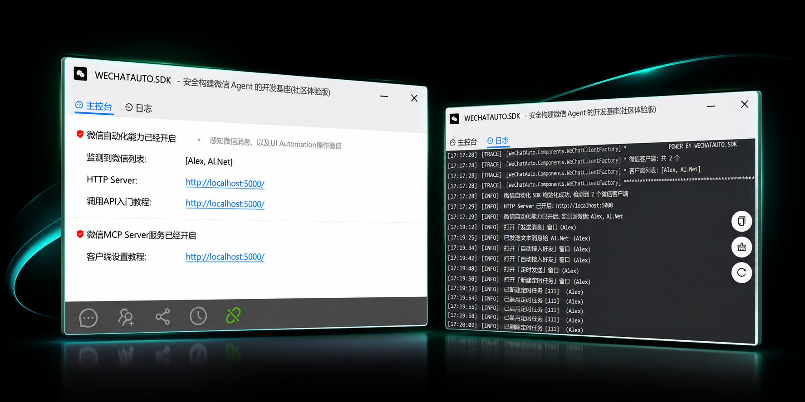
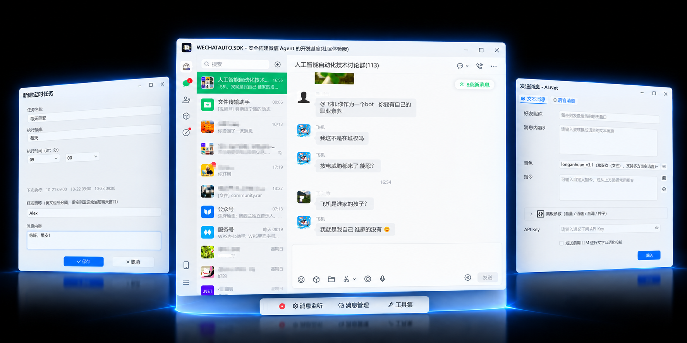

<div align="center">

# WECHATAUTO.SDK - 安全构建微信Agent的开发基座

#### 一款为Harness/SI提供操作微信核心能力的SDK，不注入(内存Hook),不数据库破解，不越权访问微信数据,通过 UI Automation 操作微信,不写一行代码获取微信消息

让你的微信 Agent/Wechat Bot 快速开发、快速上线、并安全发布到用户端

[](https://dotnet.microsoft.com/)
[](https://www.python.org/)
[](https://isocpp.org/)
[](https://go.dev/)
[](https://www.java.com/)
[](https://nodejs.org/)
[](https://www.rust-lang.org/)
[](LICENSE)

**[Website](https://scottfly189.github.io/WeChatAuto.SDK/) · [Guides](https://scottfly189.github.io/WeChatAuto.SDK/main.html#/README) · [Faq](#-faq)**

[为什么选择我们?](./docs/why.md)

</div>


> [!IMPORTANT]
> 支持微信版本为 >= 4.1.9.30 and <= 最新版微信，推荐使用最新版本的微信,WeChatAuto.SDK分两个版本： 社区版 与 VIP版，VIP版与社区版底层核心代码都一样，业务层多了一些高级功能,
> 具体请参考 [WECHATAUTO.SDK能力表](./docs/ability.md).

<div align="center">
<br />



<br/>


<br/>
</div>

> [!TIP]
> 体验提示：如果需要体验WeChatAuto.SDK的通力，我架设了一个测试导航机器人，欢迎添加微信好友体验，👉 [我要体验](./MD/Experience.md)


## 📋 系统要求

- Windows 操作系统,不支持Linux和MacOS;
- **风控风险**：频繁操作可能触发微信风控机制，建议：
   - 控制操作频率
   - 避免短时间内大量操作
   - 使用键鼠模拟器降低风险

## ✨ 快速入门

> [!NOTE]
> SDK支持两种使用方式: ```内嵌方式```(Embedded) 与 ```HTTP WebAPI``` 方式<br/>

### 如何选择开发方式?

- **内嵌方式**（Embedded）方式: 引用 WeChatAuto 类库（csproj / NuGet），在自己进程内直接调用 API，原生支持.NET,其他语言使用```P/Invoke```的方式调用```DLL```,适用于SDK直接编译进你的应用场景;<br/>
- **HTTP WebAPI** 方式: 运行独立的 Http Server 程序,吸附在你的微信上,对外暴露 REST 接口,任何能发HTTP请求的语言（.NET / Python / Rust / Go / Java / Node.js …），并且只需使用UI进行设置，不写一行代码，就能实现获取微信消息、自动接入微信好友请求等功能，也是**推荐**的使用方式;<br/>

👉 两者共享同一套核心能力（发送消息/文件/表情/语音、群操作、好友监听、朋友圈、导航等）；HTTP WebAPI 的每个接口注释里都标注了"对应 WeChatClient.xxx"。

#### 🚀 快速开始（30 秒上手）

> [!IMPORTANT]
> 使用前请用Claude code 安装.net10环境
> 更多使用请参见: [使用指南](./docs/index.html)

1. 新建一个.net10控制台项目

```csharp
dotnet new console -n demo
```

2. 修改项目属性，打开 demo.csproj 文件，把```TargetFramework```修改为```net10.0-windows```,如果你使用的是.net6.0或.net7.0，请把```TargetFramework```修改为```net6.0-windows```或```net7.0-windows```，如下所示:
```xml
<Project Sdk="Microsoft.NET.Sdk">

  <PropertyGroup>
    <OutputType>Exe</OutputType>
    <TargetFramework>net10.0-windows</TargetFramework>
    <ImplicitUsings>enable</ImplicitUsings>
    <Nullable>enable</Nullable>
  </PropertyGroup>

</Project>

```

3. 安装依赖包
  
```bash
dotnet add package Microsoft.Extensions.DependencyInjection
dotnet add package WeChatAuto4x.SDK
```

4. 把OCR模型文件放到项目根目录下(我这里是:```D:\repo\WeChatAuto.SDK\test\demo\bin\Debug\net10.0-windows\models```)，OCR模型文件下载地址：[模型文件下载](https://github.com/scottfly189/WeChatAuto.SDK/tree/master/Tools)

> 注：直接拷贝models文件夹到项目根目录下即可，或者在代码中指定模型文件路径。

5. 在 Program.cs 中编写如下代码：

```csharp
using WeChatAuto.Services;
using WeChatAuto.Components;
using Microsoft.Extensions.DependencyInjection;

var serviceProvider = WeAutomation.Initialize(options =>
{
    options.DebugMode = false;   // 可选，在生产环境建议关闭
    options.EnableOCR = true;    // 必须打开OCR
    options.IsForceOpenUITree = true; //是否强开微信的UI Tree,如果确认自己的微信UI Tree是开启的，则可以设置为False    
});

using var clientFactory = serviceProvider.GetRequiredService<WeChatClientFactory>();
//检查打开有几个微信
var wechat_list = clientFactory.GetWeChatClientNames();
Console.WriteLine($"电脑上打开微信{wechat_list.Count()}个: {string.Join(',',wechat_list)}");

// 打开第一个微信，发送消息
var client = clientFactory.GetWeChatClient(wechat_list.First());
// 给好友 AI.Net_test 发送文本消息,这里应该改成你自己的微信名称.
await client.SendMessage("AI.Net_test","hello world!!");

... 更多功能请参考文档
```

## 🎈 关于键鼠模拟器

键鼠模拟器是一类专门的硬件设备，能够模拟物理键盘和鼠标的真实输入。相较于直接调用 PostMessage、SetInput 等 API 进行注入，这类传统软件方式往往会留下可被识别的痕迹，极易被微信等应用检测为自动化行为并引发风控。而键鼠模拟器通过硬件底层发送信号，模拟出的输入和人手操作无异，从而高度还原人类使用方式，在风控安全性和隐蔽性方面具备天然优势。

实际测试表明，在微信某些高敏感操作场景（比如群聊内加好友）下，借助键鼠模拟器能有效降低被风控的概率。需要注意的是，即便是手动操作，部分极端高风险情况下也有可能触发风控。因此，强烈建议在高敏感度和易风控场景优先考虑且规范使用键鼠模拟器，以获得更稳定和安全的自动化体验。

本 SDK 同时支持纯软件自动化以及结合硬件键鼠模拟器的自动化操作，满足不同业务需求和安全等级场景下的使用选择。

关于键鼠模拟器更深度的了解，请参见：[键鼠模拟器](https://github.com/scottfly189/SKSimulator)


## 😊 关于VIP

Wechatauto.SDK分为社区版和VIP版，社区版是完全开源的，VIP版为专用私库，则提供更多的功能和更深入的技术支持。

社区版与VIP版本在代码层面，主要区别在于：VIP版本比社区版本多了20%的API接口，这些接口主要是一些高级功能和扩展能力，旨在为VIP客户提供更简单、更强大的微信自动化能力。

**🎉 VIP 客户可享受以下专属服务保障：**
- 💡 **BUG 优先响应**：出现 Bug 或有新的 Enhancement ，第一时间响应、定位和解决，保障 VIP 项目的稳定运行;
- 🚀 **专属 VIP 私有仓库**：VIP 客户将获专属私有仓库，会不定期提供丰富的应用层扩展与独享内容;
- 🚀 **一对一的专属vip服务**: 这是你加入 VIP 的核心理由,微信自动化能力由 WeChatAuto.SDK 提供深度支持，业务系统由你自由扩展，实现业务与技术的高效分工;

如需升级成为 VIP，或了解 VIP 具体权益和支持方案，👉[请与我联系](https://github.com/scottfly189/scottfly189/blob/main/vip.md)。


## 📝 许可证

本项目采用 MIT 许可证。详见 [LICENSE](LICENSE) 文件。

## 🔆 Faq
<details>
<summary>❓ 运行WechatAuto.sdk的示例自动化不了微信客户端？</summary>

回答：请按下面的步骤检查：
- 确保待自动化的微信的窗口是打开状态;
- 检查windows版本，仅支持win10+;
- 如果是最新版本的微信4.1.xx,请检查是否有UI Tree,如果没有UI Tree,请参考 [我的最新版微信没有UI Tree,这个怎么办？](https://github.com/scottfly189/WeChatAuto.SDK/issues/3)
  > 查看UI Tree的方法：下载并安装 UI Tree查看工具，如: inspect.exe或者FlaUInspect等，[下载链接](https://github.com/scottfly189/WeChatAuto.SDK/tree/master/Tools)
- 如果经过上面的步骤还不行，请联系作者，并将你的代码发给他看;
</details>

## 🤝 贡献

如果发现BUG或者有功能增强需求，欢迎提交 Issue 和 Pull Request！

## 🙏 致谢

在这里感谢那些还在为自由和正义而奋斗的人们🎉🎉

---


## ⚒️ 免责声明

本 SDK 仅供学习和研究使用，请遵守微信使用条款，不得用于任何违法违规用途。使用本 SDK 产生的任何后果由使用者自行承担。

