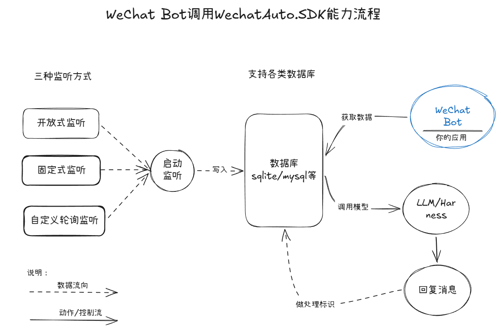
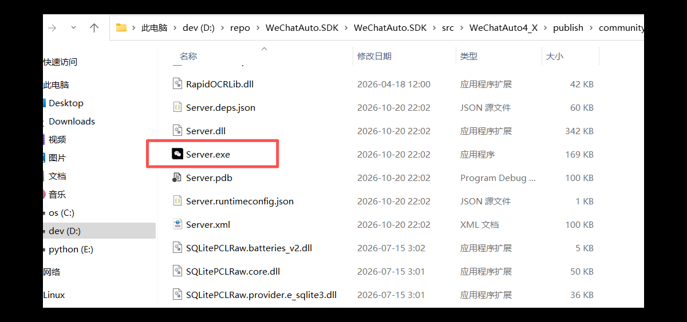
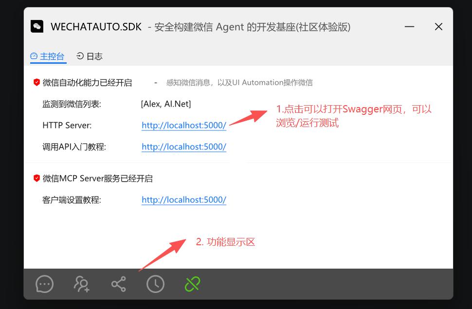
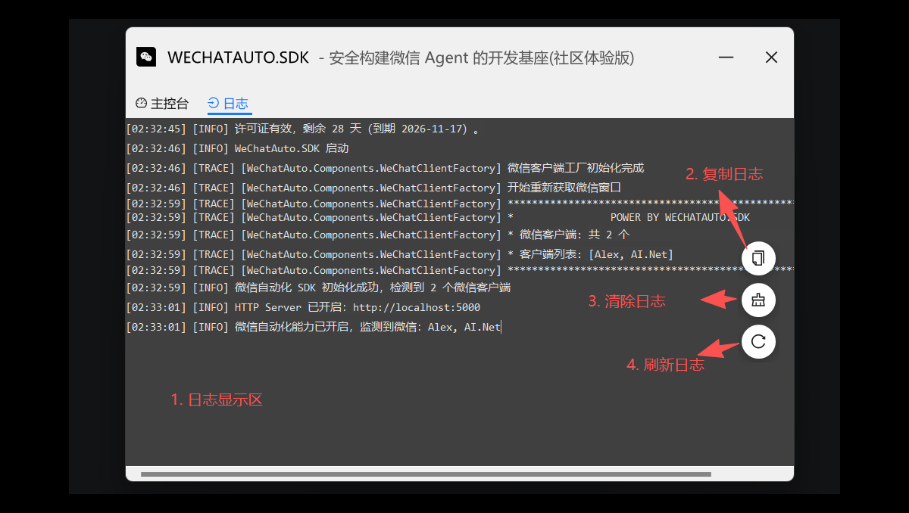
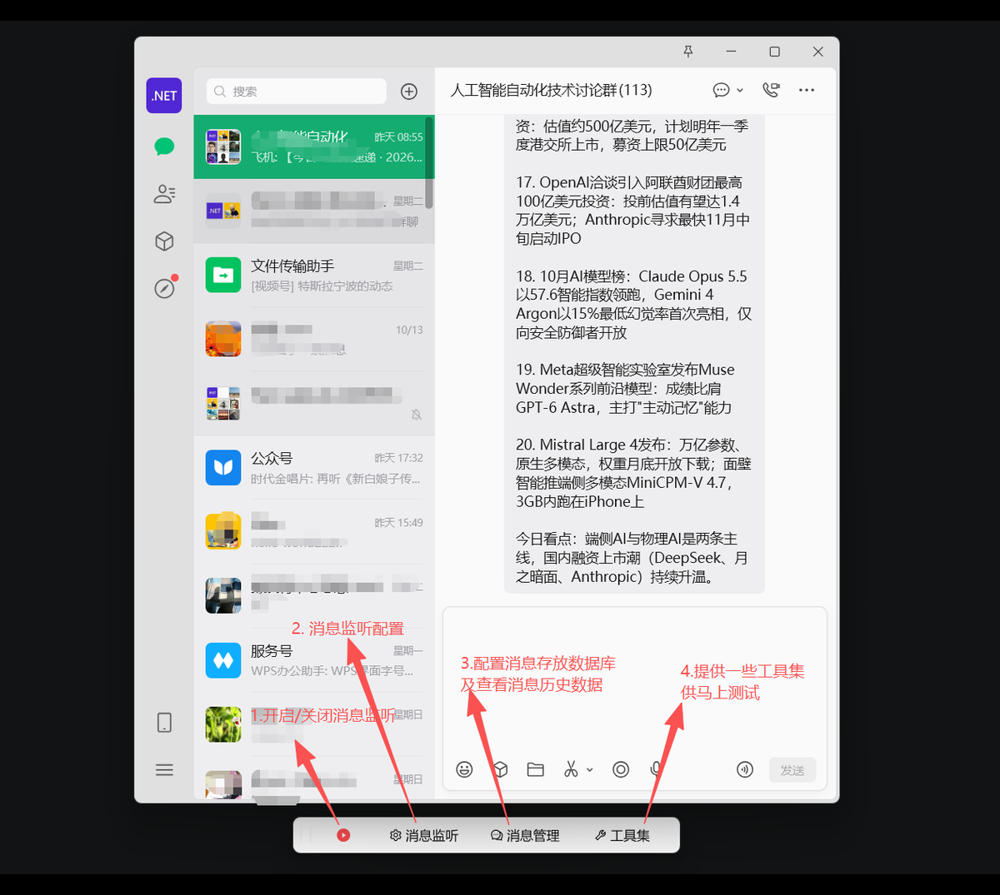
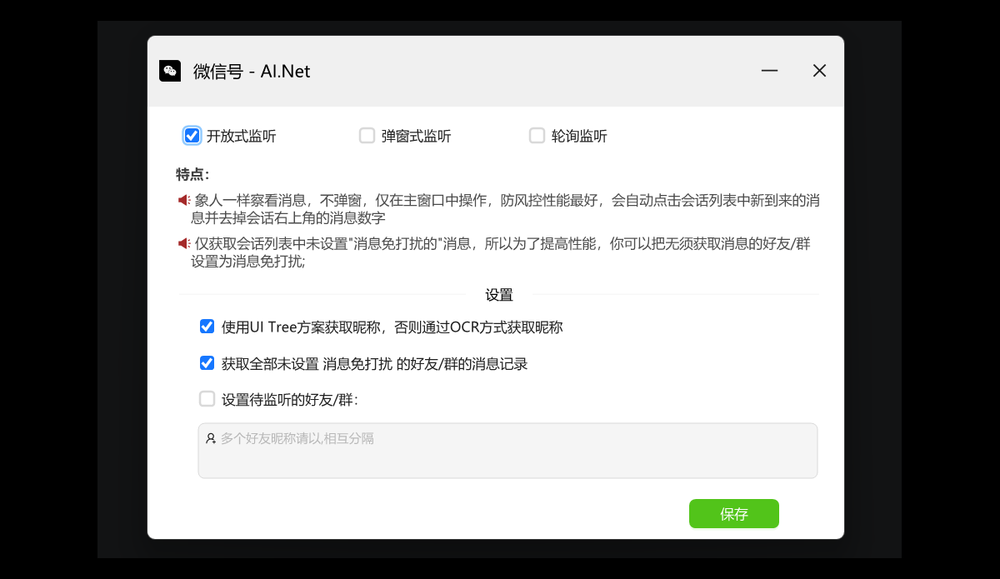
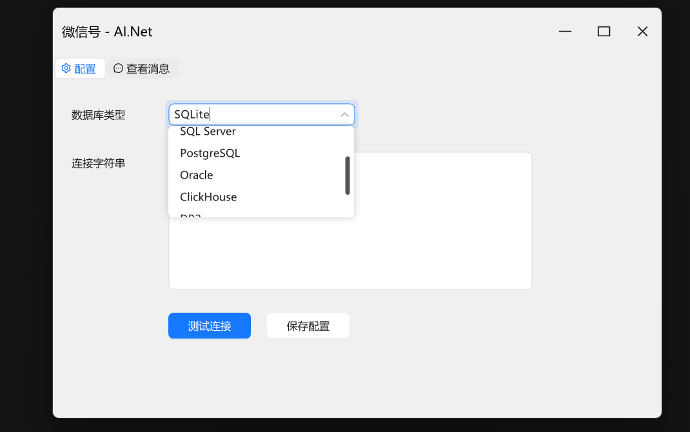
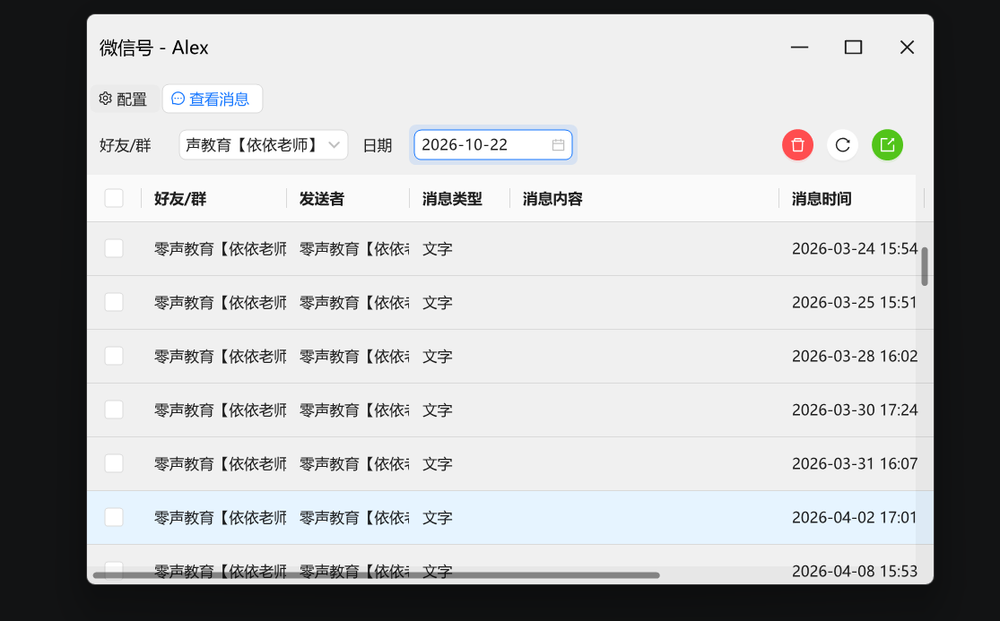

!> 如果你不是 .NET、不想管理 SDK 生命周期，或需要跨语言/远程调用,请使用 [HTTP WebAPI 方式](https://scottfly189.github.io/WeChatAuto.SDK/main.html#/httpserveruse)，<strong>`不需要书写一行代码获取微信消息`</strong>，官方推荐!

# 一、HTTP WebAPI介绍

## 适用场景
- 你的业务是后端服务 / 云服务 / 跨语言系统，需要从 Python、Go、Java、Node.js、Rust 等调用微信能力
- 需要多个业务系统共享同一个微信自动化实例，支持远程调用（局域网或云服务器），例如客服系统、运营系统、RPA、低代码平台、第三方系统对接。
- 团队/业务方不想碰 .NET，只想用 HTTP 快速集成。
- 需要开箱即用的 GUI 管理界面、Swagger 在线文档与调试、定时发送、好友自动通过等现成功能。
- 希望业务与自动化解耦：自动化作为独立服务运维，业务代码只依赖稳定的 HTTP 契约。


## 优点
- 语言无关：任何能发 HTTP、解析 JSON 的语言都能用，无需依赖 .NET;
- 进程隔离：自动化跑在独立 Server 进程里，业务系统崩溃不影响微信自动化；SDK 升级只需替换 Server;
- 可远程 / 多端共享：监听所有网卡（0.0.0.0），本机、局域网、云服务器都能访问;
- 开箱即用：自带 GUI 管理界面、Swagger 文档（可在线试调）、定时任务、好友自动通过等成品功能;
- 标准化契约：REST + snake_case JSON + 错误码（RFC 7807），可用 openapi-generator / Kiota / openapi-python-client / progenitor 自动生成各语言客户端;
- 有鉴权：X-API-Key 请求头鉴权，配合 Nginx/Caddy 反向代理加 HTTPS 可安全上公网;
- 获取好友/群的消息、自动接入好友申请等操作不需要写一行代码，只要通过设置就可以实现，极大的降低集成工作量;

## HTTP WebAPI接入原理

!> `WeChatAuto.SDK`通过`HTTP服务`服务端的UI应用直接可以获取微信消息/自动通过加好友申请！



**一般开发Wechat bot或者把微信能力集成在自己应用中的开发者有两个诉求:**

- 希望很方便的获取微信的好友/群的微信消息;
- 调用微信的能力，如：发送消息，转发消息，群管理等;

WeChatAuto.SDK HTTP WebAPI版本技术方案如下:

1. 提供`HTTP服务`服务端的UI应用,只要点击`监听`按钮,就可以监听微信消息([并支持三种消息监听方式](#二http服务使用指南))-->并写入数据库，开发者仅需要查询数据库，就可以获取好友/群的消息,`无须开发任何一行代码`。
2. `HTTP服务`服务端的UI应用只要正确开启会提供`HTTP WebAPI`服务，任何开发语言都可以通过发送`Http`请求调用微信的能力：如发送消息、进行群管理等;


## 使用步骤

!> **注意**： HTTP服务需要先下载！ 👉 [下载](https://github.com/scottfly189/WeChatAuto.SDK/releases/download/2.0.7/community_allin.rar)


#### 🚀请按下面的步骤使用:
- 请先下载[HTTP服务端](https://github.com/scottfly189/WeChatAuto.SDK/releases/download/2.0.7/community_allin.rar),放置在本机/服务器的某个目录，然后解压缩;
- HTTP服务要与需要自动化的微信放在同一台电脑上;
- 先打开微信，并登入自己账号，保持微信窗口为打开状态(非关闭状态),支持多微信; 
- 最后打开HTTP服务(运行解压缩目录的Server.exe);
- 双击或者右键屏幕右下角的HTTP服务，在弹出的控制台窗口中点击链接打开Swagger页面,在弹出的Swagger页面可以在线调试API;
- HTTP服务请参考:[HTTP服务使用指南](#http服务使用指南);
- HTTP WebAPI参考请参考:[HTTP WebAPI 接入指南](#http-webapi-接入指南);
- 其他问题请参见[FAQ](https://github.com/scottfly189/WeChatAuto.SDK/blob/master/docs/faq.md);
- 有什么问题或者功能增强要求，请提[Issues](https://github.com/scottfly189/WeChatAuto.SDK/issues);

!> 也可以浏览[在线Swagger](https://scottfly189.github.io/WeChatAuto.SDK/api-site/index.html),但请不要操作，因为服务器没有打开对应的微信,具体还是以你本地打开的HTTP WebAPI服务为准！

# 二、HTTP服务使用指南
!> 后面的WebAPI调用依赖打开`HTTP服务`, 请使用者在使用前阅读本 `HTTP服务使用指南`,重要！

**1. 请先下载[HTTP服务端](https://github.com/scottfly189/WeChatAuto.SDK/releases/download/2.0.7/community_allin.rar),放置在本机/服务器的某个目录，然后解压缩;**
**2. 在解压缩的目录中打开 `Server.exe` 应用，如下图所示:**



双击`Server.exe`就可以运行本服务端

**3. 运行后，如果成功运行，会在右下角产生一个notifyicon图标，双击这个图标，可以看到主控台，如下图所示:**



!> 这里是HTTP WebAPI的主控台，如果看到以上的界面，证明Http Server正常工作中！

- 点击`HTTP Server`右边的链接，可以打开SWagger页面，可以在弹出的Swagger页面查看API定义及进行在线测试;
- 下面的`功能显示区`显示打开/关闭监听 及 打开工具集 的状态显示;
- 如果运行失败，也会显示在主控台，你可以点击 `日志` 选项卡查看为什么失败;

**4. 在主控台点击 `日志` 选项卡，展示运行日志**

- 在日志显示区可以查看日志;
- 点击右边的 `复制` 按钮，可以把日志全部复制到剪切板，你可以把日志复制到外部保存;
- 点击右边的 `清除日志` 按钮，可以清除日志，方便调试;
- 日志不会自动刷新，请点击右边的 `刷新` 按钮刷新最新日志;



**5. 在每个窗口的底部，会产生一个吸附窗口,会随着窗口移动而移动，如下图所示:**



!> 吸附窗口与每个微信相关，当某微信获得焦点时会显示，失去焦点时会消失，把鼠标移到每个按钮上面会显示每个按钮的 `tooltips`;

- 最左边的按钮会 `开启/暂停` 消息监听,系统支持三种监听方式: `开放式监听`,`弹出子窗口监听`,`轮询监听`,所以具体开启的消息监听类型，依赖于你的设置，刚进系统默认是`开放式监听`,你可以点击右边的 `消息监听` 按钮进行配置其他的消息监听方式，具体请参见下面的 `消息监听`;
- 消息监听的结果默认写入本地 `sqlite` 数据库，你可以点击 `消息管理` 进行数据库的切换，如改成网络数据库`mysql`等等,这样可以做多微信消息的聚合。
- 注意：点击 `开启` 消息监听按钮，会自动进行监听，如果有新消息过来，会抢占鼠标，所以运行时不要与自动化抢鼠标,避免消息监听失败;

**6. 点击吸附窗口的 `消息监听` 按钮，打开消息监听的配置界面，如下图所示**



!> 顶部标题显示你处理的微信(自己的微信)，你可以在此配置界面更改消息监听方式及配置选项，所有的监听方式都支持`UI Tree方案`及`OCR`方案获取昵称，建议使用`UI Tree方案`,因为此方案结合了`UI Tree方案`及`OCR`方案，获取昵称的准确率`100%`,而纯`OCR`方案获取昵称的准确性为`96%`左右;

**三种消息监听方式的区别如下:**
  
- 开放式监听:

象人一样察看消息，不弹窗，仅在主窗口中操作，防风控性能最好，会自动点击会话列表中新到来的消息并去掉会话右上角的消息数字;

仅获取会话列表中未设置"消息免打扰的"消息，所以为了提高性能，你可以把无须获取消息的好友/群设置为消息免打扰;

👉 **适用于不设定固定好友/群的消息监听**

- 弹窗式监听:

会弹出子窗口，并在每个子窗口中监听消息，👉 **适用于固定的好友/群的消息监听**

特点是延迟最少，获取消息速度最快,适用于高效获取消息的场景;

- 轮询式监听:

不会弹出子窗口，在主窗口进行消息监听,什么时候监听，什么时候停止，完全由自己控制，适用于完全自己控制的场景;


!> 注意：如果更改了消息监听方式，不会立即生效，必须关闭应用，重新打开应用才会生效。

**7. 点击吸附窗口的 `消息管理` ,可以在这里更改数据库配置,如下图所示:**



!> 顶部标题显示你处理的微信(自己的微信),默认的数据库是`sqlite`,你可以改成自己的数据库,如`mysql`等，这样就可以做多微信消息聚合;

- 在数据库类型列表选择所需要的数据库类型;
- 在连接字符串填写上面选择的数据库类型正确的连接字符串;
- 点击 `测试连接` 可以测试数据库的连通性;
- 点击 `保存配置` 数据库会自动生效，并且之前数据库的数据也会自动`迁移`至新的数据库中;

**8. 点击`消息管理的`的`查看消息`选项框,如下图所示:**



- 点击 `好友/群` 可以选择待查看的 好友/群;
- 选择对应的`日期`,可以查看当天的 好友/群 的消息记录;
- 也可以点击右边的`删除`,`刷新消息`,`导出`按钮，做一些微信消息操作;

<details>
<summary>扩展学习：工具集</summary>
1. 发送消息: 可以测试发布消息，也可以保存昵称集合，下次发送消息的时候可以快捷选择;
2. 发送语音消息: 发送语音消息，并支持文本中插入 `控制指令` 与 `情感与富语言标签`、`高级选项`等功能，需要有通义千问的 `API Key`,请大家在[通义千问官网](https://platform.qianwenai.com/home)开通，具体语音合成教程请参见[通义千问-语音合成官网教程](https://platform.qianwenai.com/docs/developer-guides/speech/tts#%E6%8C%87%E4%BB%A4%E6%8E%A7%E5%88%B6);
3. 定时发送: 可以设定定时任务，给多人发送一条或者多条消息;
4. 消息转发: 此功能正在完善中;
5. 自动接入好友申请: 通过设定，有好友申请加你好友时，会自动通过，并可以根据每个关键词设定单独的标签与备注后缀;

!> 注： 工具集的一些设定会反馈在`控制台`的功能区中;

</details>

<br/>

# 三、HTTP WebAPI 接入指南

> 本服务是标准 HTTP RESTful 接口：任何能发 HTTP 请求、解析 JSON 的语言（.NET / Python / Rust / Go / Java / Node.js 等）都能直接调用，**无需依赖 .NET**。
>
> 每个接口的完整参数与返回结构，以运行中的 **Swagger UI** 为准：启动服务后访问 `http://<主机>:<端口>/swagger`。本文只讲「概念 + 约定 + 快速上手」——这些是 Swagger 页面本身不会教你的。

---

## 1. 接入信息

| 项 | 说明 |
|---|---|
| Base URL | `http://<主机IP>:<端口>` |
| 默认端口 | `5000`，在程序运行目录的 `App.json` 中改（`Http.Port`） |
| 传输 | 明文 HTTP（无 TLS）。服务监听所有网卡（`0.0.0.0`），本机、局域网、云服务器均可访问 |
| Swagger 文档 | `http://<主机IP>:<端口>/swagger` |

> 部署到公网/云服务器时，强烈建议通过反向代理（Nginx / Caddy）加 HTTPS，并设置 API Key（见下一节）。

## 2. 鉴权（API Key）

- 请求头：`X-API-Key: <你的Key>`
- 配置位置：`App.json` → `Http.ApiKey`
- 规则：
  - `ApiKey` 为**空**（默认）→ **不校验**，任何能访问到端口的人都能调用（适合纯内网/单机）。
  - 设置后 → 所有 `/api/**` 请求必须携带且匹配该 Header，否则返回 `401`。

```json
{
  "Http": {
    "Port": 5000,
    "ApiKey": "改成足够随机的长字符串"
  }
}
```

> 浏览 Swagger 文档（`/swagger`）**不需要** API Key；只有实际调用 `/api/**` 才需要。

## 3. 全局约定

| 项 | 约定 |
|---|---|
| 请求/响应体 | 都是 `application/json`，请求头带 `Content-Type: application/json` |
| 字段命名 | **snake_case**（小写 + 下划线），如 `at_users`、`wx_id`、`group_name`。输入大小写不敏感，输出一律 snake_case |
| 枚举 | 一律传**字符串值**（不是数字） |
| 日期时间 | ISO 8601，如 `2026-10-19` 或 `2026-10-19T14:30:00`；未写时区时按服务运行机器的本地时间解释 |
| 空返回的操作 | 写操作（POST / PUT / DELETE）成功通常返回 `204 No Content`，**没有响应体**，不要去找 body |

## 4. 状态码与错误

| 状态码 | 含义 |
|---|---|
| `200` | 成功，有返回体（JSON） |
| `204` | 成功，无返回体 |
| `400` | 参数错误 |
| `401` | API Key 缺失或不正确（仅当配置了 ApiKey） |
| `404` | `clientId` 对应的微信客户端不存在 |
| `500` | 服务器内部错误 |

错误响应体遵循 RFC 7807（`ProblemDetails`）：

```json
{ "status": 404, "title": "微信客户端不存在", "detail": "..." }
```

## 5. 核心概念（务必先读）

### 5.1 `clientId` 是什么

几乎所有接口路径都是 `api/v1/clients/{clientId}/...`。`clientId` **同时接受微信昵称或 wxid**，且**区分大小写、精确匹配**。

- 先调用 `GET /api/v1/clients` 拿到所有客户端的 `wx_id`；
- **推荐用 `wx_id`**：唯一且稳定；昵称可能重复、可能被用户改掉。

### 5.2 `who` / `group_name` 为空 = 当前焦点窗口

发消息、群操作等接口里的 `who`（或 `group_name`）字段**可留空**，留空表示作用于**当前焦点所在的聊天窗口**。这是有状态的行为，调用前请确保焦点在目标会话上（可配合 `POST .../conversations/locate` 先定位会话）。

### 5.3 副作用与微信风控

本服务驱动的是**真实微信客户端**（UI 自动化），不是幂等的纯 CRUD：

- 加好友、邀请群成员、把群成员加为好友等操作存在微信风控，**控制频率、谨慎批量**；
- 发送语音消息需要虚拟声卡（Cable input / Cable output）支持。

## 6. 快速上手（端到端）

三步：列客户端 → 取 clientId → 发消息。

> 若你的语言有对应的官方客户端 SDK，推荐直接使用第 7 节的封装库，无需手写 HTTP 请求。下面的原始 HTTP 示例用于理解协议，或你的语言没有对应 SDK 时使用。

### curl

```bash
# 1. 列出所有微信客户端
curl http://localhost:5000/api/v1/clients

# 2. 发一条文本消息（<wxid> 换成上一步的 wx_id；who 留空则发给当前焦点窗口）
curl -X POST http://localhost:5000/api/v1/clients/<wxid>/messages/send \
  -H "Content-Type: application/json" \
  -H "X-API-Key: your-key" \
  -d '{"who": "某个好友昵称", "message": "你好"}'
```

### Python

```python
import requests

BASE = "http://localhost:5000"
HEADERS = {"X-API-Key": "your-key"}   # 未配置 ApiKey 可省略

# 1. 列出客户端，取第一个的 wx_id
clients = requests.get(f"{BASE}/api/v1/clients", headers=HEADERS).json()
client_id = clients[0]["wx_id"]

# 2. 发消息
r = requests.post(
    f"{BASE}/api/v1/clients/{client_id}/messages/send",
    headers=HEADERS,
    json={"who": "某个好友昵称", "message": "你好"},
)
assert r.status_code == 204   # 写操作成功是 204，无返回体
```

### .NET

```csharp
using var http = new HttpClient { BaseAddress = new Uri("http://localhost:5000") };
http.DefaultRequestHeaders.Add("X-API-Key", "your-key");   // 未配置 ApiKey 可省略

// 1. 列出客户端
var clients = await http.GetFromJsonAsync<JsonElement>("/api/v1/clients");
var clientId = clients[0].GetProperty("wx_id").GetString();

// 2. 发消息
using var resp = await http.PostAsJsonAsync(
    $"/api/v1/clients/{clientId}/messages/send",
    new { who = "某个好友昵称", message = "你好" });
// resp.StatusCode == HttpStatusCode.NoContent
```

### Rust

```rust
use serde_json::json;

let client = reqwest::Client::new();

// 1. 列出客户端
let clients: serde_json::Value = client
    .get("http://localhost:5000/api/v1/clients")
    .header("X-API-Key", "your-key")   // 未配置 ApiKey 可省略
    .send().await?
    .json().await?;
let client_id = clients[0]["wx_id"].as_str().unwrap();

// 2. 发消息
client
    .post(format!("http://localhost:5000/api/v1/clients/{client_id}/messages/send"))
    .header("X-API-Key", "your-key")
    .json(&json!({ "who": "某个好友昵称", "message": "你好" }))
    .send().await?;
```

## 7. 官方客户端 SDK（多语言）

!>不想手写 HTTP 请求的话，仓库已提供 **7 个语言**的客户端封装、由 `swagger.json` 自动生成的官方客户端 SDK，位于 [HttpSupport/Client](https://github.com/scottfly189/WeChatAuto.SDK/tree/master/WeChatAuto4_X/HttpSupport/Client)中。

统一约定：

| 项 | 约定 |
|---|---|
| 默认 Base URL | `http://localhost:5000`（来自 `App.json` → `Http.Port`） |
| 鉴权 | 可选 `X-API-Key` 请求头（`App.json` → `Http.ApiKey`，为空时服务端不校验、客户端也不发送） |
| 接口前缀 | 客户端自动为所有请求加 `/api/v1` |
| 字段命名 | `snake_case`，严格保持 swagger 原样 |
| 响应 | swagger 中响应无 schema（仅 `200 OK`），各客户端统一返回**原始响应体**，不构造响应 DTO |
| 接口规模 | 65 个操作（7 组）、42 个数据模型/枚举 |

> ⚠️ 这些客户端由 `swagger.json` 自动生成，**未经充分测试**；接口的准确行为以本指南与 `HttpSupport/Server/Docs/api-site/swagger.json` 为准。

| 语言 | 目录 | 构建 / 测试 | 说明 |
|---|---|---|---|
| .NET (C#) | `HttpSupport/Client/.net/` | `dotnet build` / `dotnet test` | net8.0 类库，入口 `WeChatAutoClient` |
| C++ | `HttpSupport/Client/c++/` | `cmake` / `ctest` | C++17 header-only，可选 libcurl |
| Go | `HttpSupport/Client/go/` | `go test ./...` | 仅标准库，入口 `NewClient` |
| Java | `HttpSupport/Client/java/` | `mvn test` | JDK 11+ + Maven + Jackson |
| Node.js | `HttpSupport/Client/node/` | `npm test` | ES modules，Node 18+，零运行时依赖 |
| Python | `HttpSupport/Client/python/` | `python -m pytest tests/` | 仅依赖 `requests` |
| Rust | `HttpSupport/Client/rust/` | `cargo test` | `tokio` + `serde_json` |

### 快速上手：发送一条文本消息

各语言构造方式一致：传入 `baseUrl`（默认 `http://localhost:5000`）与可选 `apiKey`；方法名与接口一一对应，路径参数按位置传入。

**C#**

```csharp
using WeChatAuto.Client;
using WeChatAuto.Client.Models;

var client = new WeChatAutoClient("http://localhost:5000", "your-api-key");
await client.SendMessageAsync("wxid_xxx", new SendMessageRequest { Who = "某好友", Message = "你好" });
```

**Python**

```python
from wechatauto import WeChatAutoClient, models

client = WeChatAutoClient(base_url="http://localhost:5000", api_key="")
client.send_message("wxid_xxx", models.SendMessageRequest(who="某好友", message="你好"))
```

**Go**

```go
import wechatauto "wechatauto/client"

c := wechatauto.NewClient("http://localhost:5000", "", nil)
who, msg := "某好友", "你好"
body, err := c.SendMessage("wxid_xxx", wechatauto.SendMessageRequest{Who: &who, Message: &msg})
```

**Java**

```java
WeChatAutoClient client = new WeChatAutoClient("http://localhost:5000", "your-api-key");
SendMessageRequest req = new SendMessageRequest();
req.setWho("某好友");
req.setMessage("你好");
String rawJson = client.sendMessage("wxid_xxx", req);
```

**Node.js**

```js
import { WeChatAutoClient } from 'wechatauto-client';

const client = new WeChatAutoClient('http://localhost:5000', 'your-api-key');
await client.sendMessage('wxid_xxx', { who: '某好友', message: '你好' });
```

**Rust**

```rust
use wechatauto_client::models::{ChatRefer, ChatSimpleMessage, SendMessageRequest};
use wechatauto_client::WeChatAutoClient;

let client = WeChatAutoClient::new("http://localhost:5000");
let body = SendMessageRequest {
    who: Some("某好友".to_string()),
    message: Some("你好".to_string()),
    at_users: None,
    // 注意：生成模型里 refer 为必填字段，需构造一个空的引用对象
    refer: ChatRefer {
        date: String::new(),
        message: ChatSimpleMessage { who: None, message: None, send_date_time: None, date_time: String::new(), unique_string: None },
        is_close_search_win: false,
    },
};
client.send_message("wxid_xxx", &body).await?;
```

**C++**

```cpp
#include <wechatauto/wechatauto_client.hpp>

wechatauto::WeChatAutoClient client("http://localhost:5000", "your-api-key");
wechatauto::SendMessageRequest req;
req.who = "某好友";
req.message = "你好";
std::string result = client.sendMessage("wxid_xxx", req);
```

> 每个语言目录内都自带 README 与单元测试；测试通过 mock/fake 传输层离线验证 URL、查询参数、`X-API-Key` 头与 JSON 请求体。更多细节见 `HttpSupport/Client/README.md` 及各语言目录下的 README。

## 8. 接口参考

完整接口清单（客户端、消息、好友、群聊、会话、导航、窗口）见 Swagger UI：

`http://<主机IP>:<端口>/swagger`

该页面可直接在线试调（先点右上角 **Authorize** 填入 API Key）。

## 9. 常见问题

- **404 微信客户端不存在**：`clientId` 填错，或大小写/精确匹配不符——先用 `GET /api/v1/clients` 取准确的 `wx_id`。
- **返回 204 没有 body，是不是失败了**：不是，写操作成功就是 204。
- **有现成的客户端 SDK 吗**：有。仓库已提供 7 个语言（.NET / C++ / Go / Java / Node.js / Python / Rust）的官方客户端 SDK（见第 7 节），位于 `HttpSupport/Client/`。想自己生成或需要其他语言，仍可把 `http://<主机>:<端口>/swagger/v1/swagger.json` 交给 openapi-generator / Kiota(.NET) / openapi-python-client(Python) / progenitor(Rust) 自动生成。
